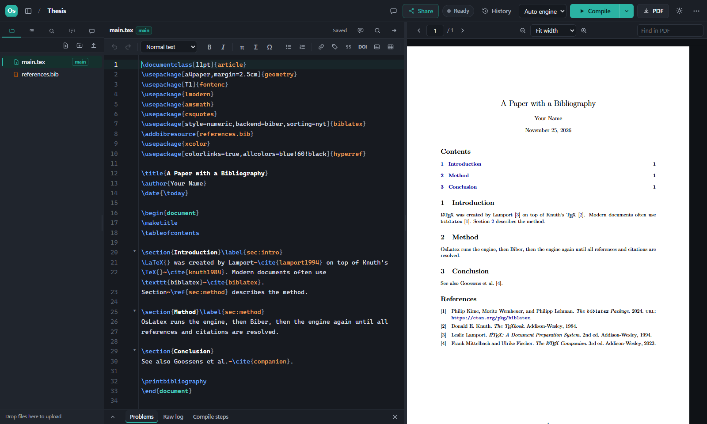
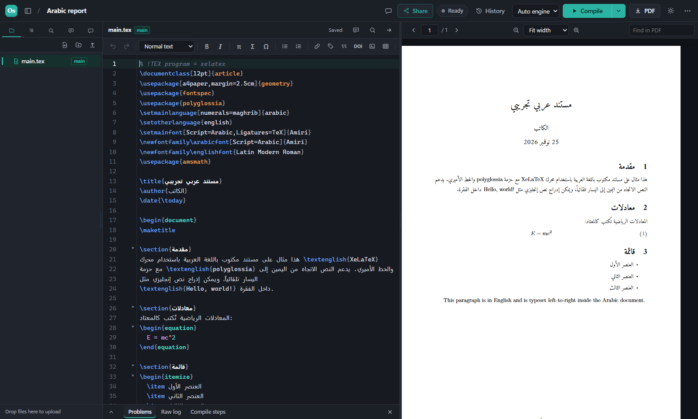

<p align="center">
  
</p>

<p align="center">
  
</p>

<p align="center">
  <a href="https://github.com/Yasir-althubyani/oslatex-releases/releases/latest"></a>
  <a href="https://github.com/Yasir-althubyani/oslatex-releases/releases/latest"></a>
  
  
</p>

<p align="center">
  
</p>

<table>
<tr>
<td width="50%" valign="top">

**A LaTeX editor for Windows that compiles with a real LaTeX engine on your own PC, with live collaboration.**

OsLatex compiles on your machine, lets you work on the same project live with friends, and can let an AI assistant fix your errors. All your files stay local: no compile time limits, no subscriptions, and full Arabic support.

**[⬇ Download OsLatex.exe (latest version)](https://github.com/Yasir-althubyani/oslatex-releases/releases/latest)**

</td>
<td width="50%" valign="top" dir="rtl" align="right">

**محرر LaTeX لنظام ويندوز يكمبايل باستخدام محرك LaTeX حقيقي على جهازك الشخصي، مع ميزة العمل الجماعي المباشر.**

OsLatex يكمبايل على جهازك، وتقدر تشتغل فيه مع خوياك على نفس المشروع لايف، وتقدر تخلي الذكاء الاصطناعي يصلح أخطاءك. كل ملفاتك تظل عندك، بدون حدود وقت كمبايل، وبدون اشتراك، ويدعم العربي بالكامل.

**[⬇ تحميل OsLatex.exe (أحدث إصدار)](https://github.com/Yasir-althubyani/oslatex-releases/releases/latest)**

</td>
</tr>
</table>

---

## ✨ Why OsLatex? · ليش OsLatex؟

| | **OsLatex** | Online editors · المحررات السحابية |
|---|:---:|:---:|
| 📁 **Where your files are** · مكان ملفاتك | **On your PC** · على جهازك | On someone's server · على سيرفرات شخص آخر |
| ⏱️ **Compile time limit** · حد وقت الكمبايل | **None**, even for a 100+ page thesis · لا يوجد حد | Free plans time out on big documents · الخطط المجانية تنتهي مهلتها |
| 📴 **Works offline** · بدون إنترنت | **Yes**, after the one-time setup · نعم | No · لا |
| 👥 **Live collaboration** · العمل الجماعي | **Free**, through your own PC · مجاناً | Often a paid plan · غالباً مدفوع |
| 🤖 **AI that edits and compiles** · ذكاء اصطناعي يعدل ويكمبايل | **Claude, Cursor, local models** | Rarely · نادراً |
| 🇸🇦 **Arabic** · اللغة العربية | **Built in** (XeLaTeX + Amiri, RTL) · مدعومة من البداية | Depends on setup · تعتمد على الإعدادات |
| 💰 **Price** · السعر | **Free** · مجاني | Free plans with limits · خطط مجانية بحدود |

---

## 🚀 Features · المزايا

### ✍️ Writing · الكتابة

<table>
<tr>
<td width="50%" valign="top">

- **A full LaTeX editor:** syntax colours, autocomplete for commands, `\ref` labels, `\cite` keys, file paths and packages, code folding, search & replace, and multiple cursors.
- **Formatting toolbar:** headings, bold/italic, math, a symbol palette (Greek, arrows, ℝ…), lists, tables, figures, links and citations.
- **Paste a screenshot (Ctrl+V)** into the editor: it's saved in `figures/` and the figure code is written for you.
- **Add a reference from a DOI or arXiv ID:** OsLatex fetches it, adds it to your `.bib` with a clean key such as `Vaswani_2017`, and inserts `\cite{…}`.
- **Outline** of the whole document and **search across all files**.
- **Arabic:** right-to-left lines and Arabic templates, and the right engine is picked automatically.

</td>
<td width="50%" valign="top" dir="rtl" align="right">

- **محرر LaTeX متكامل:** ألوان للصيغة البرمجية، إكمال تلقائي للأوامر، وسوم `\ref`، مفاتيح `\cite`، مسارات الملفات والحزم، طي الكود، بحث واستبدال، ومؤشرات متعددة.
- **شريط أدوات للتنسيق:** العناوين، غامق/مائل، رياضيات، لوحة رموز، قوائم، جداول، أشكال، روابط واستشهادات.
- **لصق لقطة شاشة (Ctrl+V):** يتم حفظها في مجلد `figures/` ويتم كتابة كود الشكل تلقائياً لك.
- **إضافة مرجع من DOI أو arXiv ID:** يجلب المرجع، ويضيفه لملف `.bib` بمفتاح نظيف، ويدرج أمر `\cite{…}` في مكان المؤشر.
- **المخطط التفصيلي (Outline)** للمستند بأكمله و**البحث في جميع الملفات**.
- **اللغة العربية:** سطور من اليمين إلى اليسار (RTL) وقوالب عربية، ويتم اختيار محرك الكمبايل المناسب تلقائياً.

</td>
</tr>
</table>

### ⚙️ Compiling · الكمبايل

<table>
<tr>
<td width="50%" valign="top">

- **Real LaTeX engines:** pdfLaTeX, XeLaTeX, LuaLaTeX, BibTeX and Biber. The PDF is the real one, not an approximation.
- **Auto engine:** XeLaTeX for Arabic and `fontspec`, LuaLaTeX when needed, otherwise pdfLaTeX. Runs as many passes as needed.
- **Clear errors:** each problem with its file and line (click to jump there) and a plain-language hint.
- **Missing package?** One click installs it automatically.
- **PDF preview** with zoom, search and links. **Double-click the PDF** to jump to that line in the source.
- **Safe:** compiles run in a sandbox that can't read your other files or use the internet.

</td>
<td width="50%" valign="top" dir="rtl" align="right">

- **محركات LaTeX حقيقية:** pdfLaTeX، XeLaTeX، LuaLaTeX، BibTeX و Biber. ملف الـ PDF الناتج حقيقي وليس تقديرياً.
- **محرك تلقائي:** يستخدم XeLaTeX للعربية، و LuaLaTeX عند الحاجة، وإلا pdfLaTeX. يقوم بتشغيل العدد المطلوب من المرات.
- **أخطاء واضحة:** كل مشكلة تظهر مع اسم الملف ورقم السطر (اضغط للانتقال) مع تلميح مبسط للخطأ.
- **حزمة مفقودة؟** ضغطة زر واحدة تقوم بتثبيتها تلقائياً.
- **معاينة PDF** مع تكبير، بحث وروابط. **انقر نقراً مزدوجاً على الـ PDF** للانتقال إلى السطر في الكود.
- **آمن:** الكمبايل يعمل في بيئة معزولة (Sandbox) لا يمكنها قراءة ملفاتك الأخرى أو استخدام الإنترنت.

</td>
</tr>
</table>

### 👥 Working together · الشغل الجماعي

<table>
<tr>
<td width="50%" valign="top">

- **Live co-editing:** everyone types in the same project at once, and edits merge without conflicts.
- **See each other:** coloured cursors with names, and **Follow** mode.
- **Comments & Chat:** leave notes on text, chat inside the project, and share one live PDF.
- **Invite links** that can edit or only view. Remove a link and that person is out immediately.
- It runs over **Tailscale** (free): the project stays on your PC and friends connect from home.

</td>
<td width="50%" valign="top" dir="rtl" align="right">

- **تعديل مباشر مشترك:** الجميع يكتبون في نفس المشروع في نفس الوقت، ويتم دمج التعديلات دون تعارض.
- **شوف بعضكم:** مؤشرات ملونة بأسماء المشاركين، ووضع **المتابعة (Follow)**.
- **تعليقات ودردشة:** اترك ملاحظات على النص، دردش داخل المشروع، وشارك ملف PDF واحد يتحدث للجميع.
- **روابط دعوة** تسمح بالتعديل أو المشاهدة فقط. أزل الرابط ليخرج الشخص فوراً.
- يعمل عبر **Tailscale** (مجاناً): يبقى المشروع على جهازك ويتصل أصدقاؤك من منازلهم.

</td>
</tr>
</table>

### 🤖 AI assistants · الذكاء الاصطناعي <sup>new · جديد</sup>

<table>
<tr>
<td width="50%" valign="top">

- **Claude, Cursor, VS Code or a local model (LM Studio)** can work on your projects.
- They read and edit the files, **compile and fix the errors**, install missing packages, add references and answer comments.
- **You see their edits live** in the editor, like a friend typing.
- History keeps a version from before their first change, so you can always go back.
- **One click for Claude Desktop:** ⋯ → *Connect an AI assistant* → *Add to Claude Desktop*.
- Your files stay on your PC: the assistant only reaches your projects.

</td>
<td width="50%" valign="top" dir="rtl" align="right">

- **Claude أو Cursor أو VS Code أو موديل محلي (LM Studio)** يقدر يشتغل على مشاريعك.
- يقرأ الملفات ويعدلها، **يكمبايل ويصلح الأخطاء**، يثبت الحزم الناقصة، يضيف المراجع ويرد على التعليقات.
- **تشوف تعديلاته لايف** في المحرر، كأنه واحد من خوياك يكتب.
- السجل (History) يحفظ نسخة قبل أول تعديل له، فتقدر ترجع لها في أي وقت.
- **ضغطة وحدة لـ Claude Desktop:** ⋯ ← *Connect an AI assistant* ← *Add to Claude Desktop*.
- ملفاتك تظل على جهازك: الموديل يوصل لمشاريعك بس.

</td>
</tr>
</table>

Then just ask · بعدها اطلب منه بس:

```text
List my OsLatex projects.
Compile my thesis and fix every error.
Add 10.48550/arXiv.1706.03762 to my references and cite it in the introduction.
Answer the open comments in the Arabic report.
```

### 🛟 Safety net · الأمان

<table>
<tr>
<td width="50%" valign="top">

- **Automatic saving & History:** saves a version every compile and every 10 minutes. Compare versions line by line and restore any of them.
- **Undo per person:** Ctrl+Z only undoes *your* changes.
- **Recently deleted:** restore a deleted project from the start page.
- **Automatic updates:** OsLatex checks once a day and updates itself with one click.

</td>
<td width="50%" valign="top" dir="rtl" align="right">

- **حفظ تلقائي وسجل (History):** يحفظ نسخة عند كل كمبايل وكل 10 دقائق. قارن بين الإصدارات سطراً بسطر واستعد أي منها.
- **تراجع لكل شخص:** Ctrl+Z يقوم بالتراجع عن تغييراتك *أنت* فقط.
- **المحذوفة حديثاً:** استعد مشروعاً محذوفاً من صفحة البداية.
- **تحديثات تلقائية:** يتحقق البرنامج يومياً ويحدث نفسه بضغطة زر.

</td>
</tr>
</table>

---

## 🇸🇦 Arabic, from the first line · العربي من أول سطر

<p align="center">
  
</p>

---

## 📥 Install · التثبيت

<table>
<tr>
<td width="50%" valign="top">

1. **Download** `OsLatex.exe` from [Releases](https://github.com/Yasir-althubyani/oslatex-releases/releases/latest) and put it in its own folder (e.g., `Documents\OsLatex`).
2. **Run it.** If Windows shows *"Windows protected your PC"*, click **More info → Run anyway** (the app isn't commercially code-signed).
3. **First time only:** choose **Standard** and click **Install**. It's about 0.6 GB and takes 10–20 minutes.

</td>
<td width="50%" valign="top" dir="rtl" align="right">

1. **قم بالتحميل:** نزّل `OsLatex.exe` من صفحة [Releases](https://github.com/Yasir-althubyani/oslatex-releases/releases/latest)، وحطه في مجلد لحاله (مثلاً `Documents\OsLatex`).
2. **شغّله:** إذا طلع لك "Windows protected your PC"، اضغط **More info** بعدين **Run anyway** (لأن التطبيق غير موقّع تجارياً).
3. **أول مرة فقط:** اختر **Standard** واضغط **تثبيت (Install)**. حجمه تقريباً 0.6 GB، ويأخذ بين 10 و20 دقيقة.

</td>
</tr>
</table>

**Requirements · المتطلبات:** Windows 10 or 11 (64-bit) · ويندوز 10 أو 11 (64-بت) — about 2 GB of free disk space for the LaTeX environment · تقريباً 2 GB مساحة فاضية لبيئة LaTeX.

---

<p align="center">
  <sub>This repository only holds the downloads; OsLatex's source code is private.<br>هذا المستودع يحتوي فقط على ملفات التحميل؛ الكود المصدري لـ OsLatex خاص.</sub>
</p>

<p align="center">
  
</p>
